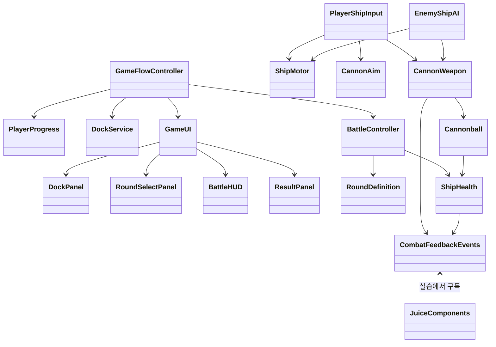

# 해상 전투 실습 — 확정 설계

## 요구사항
Unity 6000.0.57f1 / URP 2D / Input System. 플레이어 한 척.
W/S 전진·후진, A/D 선회, 마우스 자유 조준, 좌클릭 발사.
직선 포탄, 커서 거리와 사거리 표시. 포물선은 후속 시각 인디케이터 실습이다.
정비 → 라운드 선택 → 전투 → 결과 → 정비. 라운드 3개, 적 전멸 승리.
내구도 유지, 골드 수리/공격력/재장전 강화, 패배 시 무료 50% 기본 수리.
저장은 실행 중에만 유지. 기본 씬 제공. Juice는 주석만 있는 빈 MonoBehaviour.

## 관계도 (구현 전 확정)

## 책임과 소유권
- GameFlowController: 단일 상태 전환 진입점. 전투 종료 시 결과를 한 번만 정산.
- PlayerProgress: 순수 C# 실행 중 데이터. 골드, 강화 레벨, 내구도. 파일 저장 없음.
- DockService: 수리/강화 비용과 거래. UI는 금액을 직접 수정하지 않음.
- RoundDefinition: ScriptableObject. 적 수, 체력, 공격력, 보상, 제한 영역.
- BattleController: 전투 컨테이너, 선박 생성, 승패, 전투 객체 정리. 생성 중 판정하지 않음.
- ShipMotor: Rigidbody2D 이동/선회/전장 경계. UI와 무관.
- ShipHealth: 진영/내구도/사망. 사망한 선박은 입력과 AI가 정지.
- CannonAim: 마우스의 월드 좌표와 커서 거리, 사거리 판정. 최소한의 직선 안내.
- CannonWeapon: 재장전/사거리/발사. Player와 AI가 같은 무기 사용.
- Cannonball: 연속 구간 CircleCast로 빠른 포탄 누락 방지. 적/섬 충돌, 아군 통과.
- EnemyShipAI: 목표와 거리 유지, 선회/전진, 사거리 안 포격.
- GameUI와 4개 Panel: 화면 표시/버튼, 전투 HUD. 상태 변경 권한은 Flow에 있음.
- CombatFeedbackEvents: 전투당 하나인 이벤트 허브. static 이벤트를 쓰지 않아 Play 반복 시 잔존 없음.
- Juice 클래스: 기본 상태에서 필드/메서드/구독 없음. 사용자가 각 실습에서 추가.

## 이벤트 계약
ShotFired(ShotFeedback): 발사 성공 후. 발사자, 포구 위치, 방향, 진영.
Hit(HitFeedback): 피해 적용 후. 대상, 위치, 실제 피해량, 진영.
Sunk(SinkFeedback): 내구도 0이 되는 단 한 번. 대상, 위치, 진영.
WaterMiss(Vector2): 충돌 없이 최대 거리 도달 또는 섬 충돌.
BattleEnded(BattleResult): 승패, 생존 내구도, 격침 수, 골드 보상, 소요 시간.
Hit는 Sunk보다 먼저 발생. UI 위 클릭/범위 밖/재장전 중에는 ShotFired 없음.
승패는 프레임 말에 확인하여 같은 프레임 동시 격침은 패배 우선.
사망 객체는 즉시 입력/물리를 비활성화하고 2초 후 제거하여 격침 실습의 참조를 유지.

## 씬 전략
Assets/PirateGame/Scenes/PirateBattle.unity에 모든 화면과 전장을 직렬화.
에디터 생성기는 새 전용 폴더만 사용하며 기존 SampleScene은 수정하지 않음.
씬에 런타임 조립 의존 없음. GameFlowController.Start는 정비 화면 진입만 수행.
Assets/PirateGame/Prefabs, Data, Materials에 에셋 분리.
원본 Kenney 에셋은 변경하지 않고 필요한 이미지 복사본만 Sprite Single/PPU 100으로 설정.

## 초기 밸런스
시작 골드 100, 체력 100. 수리 1 HP당 1 gold.
공격력 20(+5/level), 재장전 0.8초(각 단계 0.9배), 강화 최대 5.
공격력 강화 50*(현재레벨+1), 재장전 60*(현재레벨+1).
플레이어 이동 3.5, 후진 1.75, 선회 110도/초, 사거리 8, 포탄 속도 10.
적: 2/3/4척, HP 40/60/80, 공격력 8/10/12, 보상 80/120/180.
패배 위로금 20+격침수*10. 무료 복구 체력 50. 전투 전에 값 스냅샷 적용.
