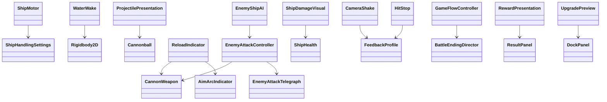

# 2차 튜토리얼 — 클래스와 상태 확장 설계

상태: 기능별 튜토리얼과 TODO 빈 클래스 11개 제공. 아래 기능·이벤트·상태는 게임에 아직 적용하지 않았습니다.
1차의 [확정 설계](../01_Architecture.md)와 구분되는 확장안입니다.

## 1. 기존 책임 유지

GameFlowController는 상태 전환과 실제 보상 지급, BattleController는 전투 진행과 승패 판단을 담당합니다.
ShipHealth는 피해와 사망 확정, CannonWeapon은 발사 조건과 재장전, Cannonball은 직선 이동과 충돌을 담당합니다.
표현 클래스는 내구도·골드·강화 레벨을 직접 변경하지 않습니다.

## 2. 확장 지점

| 단원 | 기존 대상 | 새 클래스·데이터 초안 | 책임 |
|---|---|---|---|
| 2-01 | ShipMotor | ShipHandlingSettings | 직접 이동/관성 이동 선택과 가속·제동·선회 수치 |
| 2-02 | Rigidbody2D | WaterWake | 실제 속도에 따른 항적과 물보라 |
| 2-03 | Cannonball | ProjectilePresentation | 그림자·궤적과 표현 수명 |
| 2-04 | CannonWeapon, AimArcIndicator | ReloadIndicator | 재장전 표시와 완료 상태 전이 |
| 2-05 | EnemyShipAI, CannonWeapon | EnemyAttackController, EnemyAttackTelegraph | 공격 예약·취소와 예고 표시 |
| 2-06 | CameraShake, HitStop, ShipHealth | FeedbackProfile, ShipDamageVisual | 상황별 강도와 손상 표시 |
| 2-07 | GameFlowController, BattleController | BattleEndingDirector | 결과 확정 이후의 표시 연출 |
| 선택 확장 | HitStop, BattleEndingDirector | GameTimeController | Hit Stop과 슬로모션 시간 배율 요청 통합 |
| 2-08 | ResultPanel, DockPanel | RewardPresentation, UpgradePreview | 숫자 표시와 구매 전후 비교 |

클래스 목록은 책임 설계입니다. 필드·메서드·이벤트 계약은 각 단원의 구현 시작 전에 확정합니다.

## 3. 이동 확장과 1차 호환

현재 PlayerShipInput과 EnemyShipAI는 구체 타입 ShipMotor에 의존합니다.
ShipMotor는 sealed이므로 단순 상속으로 교체할 수 없고, 새 모터를 추가하면 두 모터가 동시에 물리를 제어할 수 있습니다.

기본 방안:

- SetInput 입력 창구를 유지합니다.
- ShipHandlingSettings가 없으면 기존 직접 이동 계산을 그대로 사용합니다.
- 2차 프리팹에만 관성 이동 설정을 지정합니다.
- FixedUpdate에서는 직접 이동과 관성 이동 중 하나만 실행합니다.
- 공용 코드를 수정한 뒤 1차 기본 루프 검증을 실행합니다.

이동 인터페이스 추출은 별도 심화 과제로 다룹니다.

## 4. 공격 예고 계약

1차 ShotFired/Hit/Sunk/WaterMiss 이벤트를 유지합니다.
예고에는 AttackTelegraphed/AttackCancelled 알림을 추가하는 방안을 사용합니다.
데이터는 공격자, 확정 목표 월드 위치, 예고 시간, 공격 요청 ID를 포함합니다.

예고 시작은 발사 성공이 아닙니다. 실제 발사 성공 시점에만 재장전과 ShotFired를 처리합니다.
예고가 끝났을 때 저장한 위치가 현재 사거리 밖이면 공격을 취소하고 표시를 제거합니다.
적 사망·전투 종료·비활성화 시 예약 공격과 표시를 반드시 취소합니다.

## 5. 종료 상태

1차: Dock → RoundSelect → Battle → Result → Dock.
2차: Dock → RoundSelect → Battle → BattleEnding → Result → Dock.

| 시점 | 처리 |
|---|---|
| 승패 판단 | 동시 격침은 기존과 같이 패배 우선 |
| BattleEnding 진입 | 승패·내구도·격침 수·보상·전투 시간을 스냅샷으로 확정 |
| 연출 중 | 이동·발사·AI·추가 피해 차단, Visual·입자·오디오 유지 |
| 연출 완료 | 확정 결과로 한 번만 정산하고 결과창 표시 |
| 중복 완료 요청 | 이미 처리한 전투 ID이면 무시 |
| 정비 복귀·씬 종료 | 연출 취소, 시간 배율 복구, 객체 정리 |

BattleController는 결과 확정을 알리고 GameFlowController가 Director에 연출을 요청합니다.
Director가 경제 데이터를 변경하거나 승패를 다시 판정하지 않도록 합니다.
BattleEnded의 재사용 여부 또는 BattleResolved 분리는 구현 전에 확정하고 정산 진입점은 하나로 유지합니다.

## 6. 시간 배율과 1차 효과

1차 HitStop 예제와 CameraShake는 Battle 이외 상태에서 복구·종료합니다.
BattleEnding만 추가하면 마지막 격침 효과가 즉시 종료될 수 있으므로 상태 허용 범위를 함께 설계해야 합니다.
결과 전환 타이머는 unscaled 시간을 사용합니다. 기본 단원은 정상 시간 배율로 시작합니다.

슬로모션 선택 확장에서는 GameTimeController 한 곳만 Time.timeScale에 값을 씁니다.
우선순위는 Hit Stop > 종료 슬로모션 > 정상 시간입니다.
기존 HitStop과 새 컨트롤러가 동시에 시간 배율을 쓰지 않도록 요청 방식으로 변경합니다.
비활성화·상태 전환·씬 종료 시 요청을 해제합니다.

## 7. Visual 계층

권장 계층은 ShipRoot → ImpactPivot → RecoilPivot → Visual입니다.
ShipRoot는 물리 이동, ImpactPivot은 피격 밀림, RecoilPivot은 발사 반동, Visual은 스프라이트와 격침 축소·회전을 담당합니다.
Wake와 BowSplash는 루트 아래 별도 자식으로 둡니다.
1차 CannonRecoil의 Visual 참조는 RecoilPivot으로 다시 연결합니다.
ShipHitFlash는 실제 SpriteRenderer, ShipSinkingEffect는 격침 대상 Visual을 참조합니다.
각 효과는 자기 Transform 기준값만 복구하도록 합니다.

## 8. 관계도 초안

## 9. 검증 경계

- 기존 44개 검사는 기본 즉시 결과 전환을 전제로 합니다. 2차에는 종료 대기를 허용하는 별도 검증 흐름을 구성합니다.
- 기본 씬에 2차 관성 설정이나 공격 컨트롤러가 섞이지 않았는지 확인합니다.
- 예고 중 적 격침, 마지막 동시 격침, 연출 중 씬 종료, 카운트업 중 화면 이동을 확인합니다.
- 효과를 꺼도 전투 판정과 정산이 정상 완료되어야 합니다.
- 화면 표시 수치와 실제 이동·발사·피해·경제 데이터를 각각 확인합니다.
## 10. 기능별 구현 문서
현재 구현 예제와 Unity 연결 절차는 [개별 튜토리얼 목록](README.md)에 정리했습니다.
ShipHandlingSettings, WaterWake, ProjectilePresentation, ReloadIndicator, EnemyAttackTelegraph,
EnemyAttackController, FeedbackProfile, ShipDamageVisual, BattleEndingDirector,
RewardPresentation, UpgradePreview는 Scripts/Feel에 빈 클래스로 생성했습니다.
GameTimeController와 슬로모션 요청 통합은 선택 확장 설계이며 이번 구현 예제에는 포함하지 않습니다.
1차 공용 스크립트와 씬은 변경하지 않았습니다. 필요한 교체 코드는 각 단원에서 직접 적용합니다.